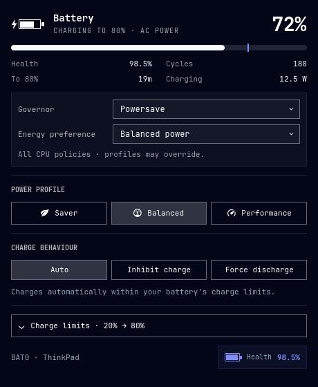

# PowerKit

Maintained by **Elias Sabat**.

Battery care and power profiles for the **Omarchy Quattro** bar. PowerKit combines a Rust backend, a native QML panel, [batctl](https://github.com/Ooooze/batctl) charge limits and power-profiles-daemon profiles.



## Install

Install on Omarchy Quattro with:

```bash
omarchy plugin add https://github.com/sabb4th/omarchy-powerkit.git --enable
```

On first use, PowerKit checks its dependencies. If anything is missing, one terminal opens with an installation summary and a **Continue?** confirmation. Omarchy installs the missing Arch packages and Ooooze's `batctl-tui` from the AUR; authentication may be required. The unrelated mesh-networking `batctl` package is not accepted. No separate setup commands are needed.

With your confirmation, setup also enables and starts `power-profiles-daemon` if necessary. It refuses to switch while TLP, auto-cpufreq or tuned is active. Battery limits and power profiles are not changed by setup. Omarchy's graphical polkit agent must be running for hardware controls.

The Rust backend builds once as your normal user with locked Cargo dependencies, then runs from the user cache. Source updates rebuild automatically. Dependency installation and compilation require network access; subsequent monitoring does not. If setup is cancelled or fails, it does not reopen repeatedly: run `bash scripts/setup.sh` from the installed plugin directory to retry. `install.sh` uses the same dependency preparation; prebuilt releases skip compiler installation.

Omarchy's native installer does not execute `install.sh`: first-use preparation is handled by the source launcher. The marketplace's installation label remains subject to maintainer review.

## Use

- **Left-click:** open or close the panel. **Escape:** close it.
- **Right-click:** cycle seven bar formats. **Middle-click:** refresh.
- **CPU controls:** the active governor and energy-performance preference replace Capacity/Design. Select supported values such as Powersave, Performance, Balanced power (`balance_power`) or Balanced performance (`balance_performance`). Changes apply to every active CPU policy with system authentication. Mixed-policy states and unsupported controls are shown explicitly. These are live overrides: power profiles can change them again; PowerKit does not persist or continuously enforce them. With active Intel P-state and the Performance governor, select Powersave before changing the preference.
- **Profiles:** Saver → Balanced → Performance, limited to profiles actually offered by the daemon. Uses Omarchy's standard source-aware bridge to remember the AC/battery choice.
- **Charge behaviour:** Auto, Inhibit charge and Force discharge, restricted to the selected battery's advertised modes. A short description explains the current mode.
- **Charge limits:** expand for four hardware-adapted batctl presets, custom start/stop limits, boot/resume persistence and saved-limit restoration.

The footer shows battery health as plain text with the Omarchy theme font and text color. Middle-click the bar to refresh. The panel shows health, charge cycles, CPU governor/energy preference, power and estimated runtime or time to the charge limit. Temperature and voltage appear when temperature telemetry exists. Missing values display `—`. The interface is English; the appearance follows your Omarchy theme.

**Charge behaviour applies to the selected battery. Thresholds apply to all batteries through batctl.** Auto follows normal charging policy and limits. Inhibit charge pauses charging; power routing depends on hardware. Force discharge uses the battery even on AC power: select Auto to stop it. Behaviour is not saved or replayed by PowerKit. The persistence switch saves **thresholds only**. When persistent thresholds change, PowerKit updates the saved values too; a failed save is reported separately from live application.

The charging indicator is a solid lightning bolt to the **left** of the battery. Its compact space expands smoothly only while charging, leaving no empty bolt slot on battery. Charge level, bolt visibility, display-format changes, hover and open states use short transitions; the fill remains solid. There is no hover tooltip and no continuous animation while idle.

## Permissions and dependencies

Read-only monitoring requires no authentication. Charge changes request standard system authentication through polkit. Thresholds/persistence use `pkexec /usr/bin/batctl`; behaviour uses the same kernel `charge_behaviour` interface as batctl's backend through a validated `pkexec /usr/bin/tee` operation, because batctl's current CLI has no setter. CPU changes use a fixed `pkexec /usr/bin/tee` invocation after validating every discovered CPU policy, the advertised options and Intel Performance/EPP constraints; values are read back after applying. A failed multi-policy write may be partial and is reported. Profile changes use the daemon's normal permissions. No custom root helper or polkit policy is installed. See [SECURITY.md](SECURITY.md) for exact privilege boundaries.

QML is the shell's frontend format; the backend is Rust. The daemon's own `powerprofilesctl` may internally use Python. Runtime network access and telemetry are not used.

## Update and remove

```bash
omarchy plugin update io.github.sabb4th.powerkit
omarchy plugin remove io.github.sabb4th.powerkit
```

For a manually copied installation, rerun `install.sh` to update and use `bash uninstall.sh` to disable and archive it. Removing PowerKit does not reset thresholds, modes, batctl services or power profiles. Persistent files are intentionally retained:

| Location | Contents |
| --- | --- |
| `$XDG_STATE_HOME/omarchy-powerkit` (default `~/.local/state/omarchy-powerkit`) | Private display preferences and manual-installer backups |
| `$XDG_CACHE_HOME/omarchy-powerkit` (default `~/.cache/omarchy-powerkit`) | Compiled source-launcher cache |
| `/etc/batctl.conf` and batctl's systemd units | Managed by batctl only when persistence is explicitly requested |

## Upgrade from Battery Studio / the old TLP repository

The project was renamed from `tlp-omarchy-plugin`; the new permanent plugin ID is `io.github.sabb4th.powerkit`. From a source checkout:

```bash
bash install.sh --migrate
# Or use an already-built backend:
bash install.sh --migrate --prebuilt target/release/powerkit
```

Only `--migrate` authorizes the installer to back up `shell.json`, replace the exact old `local.battery-studio` ID in place and archive the old plugin directory. It preserves the bar position and other widget settings. Ordinary installation does not rewrite that configuration. Display preferences fall back to the old state directory until first saved under the new name. Old histories, TLP helper files and TLP configuration remain untouched and unused.

## Development

```bash
bash check.sh
cargo build --release --locked
./target/release/powerkit sample
bash scripts/package.sh
```

Checks require Rust `rustfmt`/`clippy`, Python 3 for isolated distribution tests, jq, and Node.js or Deno. The Omarchy validator runs when available locally; CI also runs the official validator pinned to a known Omarchy revision. GitHub Actions tests and packages each push; version tags produce checksummed Linux x86_64 release archives containing the executable and reviewable sources.

The Rust process exchanges JSON lines with QML, polls every 5 seconds while open and 30 seconds otherwise, and exits on stdin EOF. Display preferences are atomically written with mode 0600. The launcher cache key includes the manifest, lockfile and Rust source, so native plugin updates rebuild when needed.

See [validation notes](VALIDACAO.md), [marketplace submission](docs/marketplace-submission.md) and [release checklist](docs/PUBLISHING.md). MIT license; UI structure is inspired by Omarchy's standard power panel. The preview uses simulated readings. Older screenshots under `previews/` document previous versions.
