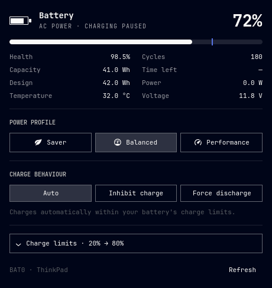

# Battery Studio · Omarchy

Backend em Rust, interface QML inteiramente em inglês, limites pelo [batctl](https://github.com/Ooooze/batctl) e perfis pelo power-profiles-daemon. A janela segue a organização do [painel de energia do Omarchy](https://github.com/omacom/omarchy/tree/246f33a2fef66411c990860d88e0823ae83987fc/shell/plugins/panels/power): porcentagem em destaque, barra de carga, indicadores em duas colunas e botões de perfil lado a lado.

A aparência da barra continua igual: clique esquerdo abre o painel, direito alterna entre os sete formatos e meio atualiza. A seção de ajustes foi removida; a aparência é configurada somente na barra. Preferências antigas de idioma são ignoradas.



## Controles

- **Power profile:** perfis disponíveis no daemon, usando a integração padrão do Omarchy para lembrar a escolha para tomada ou bateria.
- **Charge behaviour:** Auto, Inhibit charge e Force discharge, com o estado atual destacado e uma explicação curta. São mostrados apenas os modos oferecidos pelo driver da bateria selecionada.
- **Charge limits:** seção expansível com os quatro presets do batctl, limites personalizados, persistência após reinício/suspensão e restauração dos limites salvos.

O painel informa saúde, ciclos, capacidade atual e de projeto, potência e autonomia estimada (ou tempo até o limite de carga). Temperatura e tensão aparecem quando existe leitura de temperatura. Dados ausentes aparecem como `—`.

**Os modos de carga valem para a bateria selecionada. Os limites do batctl valem para todas as baterias.** Auto segue a política normal de carga e seus limites; Inhibit charge pausa o carregamento; Force discharge usa a bateria mesmo na tomada. Para sair da descarga forçada ou voltar a carregar, selecione Auto. O comportamento elétrico depende do hardware.

A CLI instalada do batctl não oferece um comando para trocar o modo. O plugin usa o mesmo atributo `charge_behaviour` do kernel que o backend do batctl, com `/usr/bin/pkexec /usr/bin/tee`, validação da bateria e uma lista restrita dos modos realmente suportados. Não usa shell nem helper privilegiado próprio. O modo não é salvo nem reaplicado pelo plugin; a persistência é somente dos limites.

## Instalar

Requer Omarchy com API de plugins Quickshell, Rust/Cargo para compilar, `batctl-tui` do projeto Ooooze (`/usr/bin/batctl`), power-profiles-daemon configurado, `jq`, `/usr/bin/tee`, polkit e agente gráfico de autenticação. Para desenvolvimento, também são usados `clippy`, `rustfmt` e Node.js ou Deno.

```bash
bash check.sh
bash install.sh
# Para instalar o binário já compilado:
bash install.sh --prebuilt target/release/battery-studio
```

O instalador arquiva a versão anterior, preserva o ID e a posição de um widget já habilitado e instala apenas os arquivos necessários em `~/.config/omarchy/plugins/local.battery-studio`. Não instala pacotes nem altera serviços de gerenciamento de energia. Os controles solicitam autenticação do sistema.

Ao alterar limites com persistência ativa, o plugin também atualiza os valores salvos pelo batctl. Se essa etapa falhar, o painel avisa que os limites foram aplicados, mas não salvos.

```bash
bash uninstall.sh
```

A desinstalação desativa e arquiva o plugin sem modificar bateria, serviços do batctl, perfis ou estado salvo. Arquivos e históricos da antiga versão TLP são preservados, mas não usados. As imagens antigas em `previews/` mostram a versão 1.

Veja [README.md](README.md) para o protocolo e os comandos de desenvolvimento, e [VALIDACAO.md](VALIDACAO.md) para a validação.
